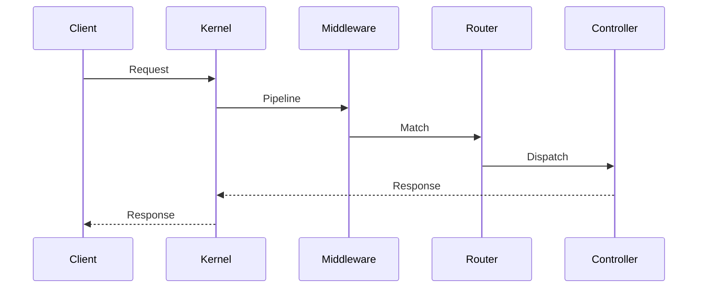

# DOC-015 — استاندارد مستندسازی تَوان (Documentation Standard)

| متادیتا | مقدار |
|---|---|
| DOC-ID | DOC-015 |
| هدف | یکدستی همهٔ مستندات تا انسان و ایجنت AI بتوانند بدون ابهام مصرف کنند |
| قالب‌ها | `docs/templates/engine-spec-template.md`, `module-template.md`, `adr-template.md` |

---

## ۱. اصول مستندسازی

| # | اصل |
|---|---|
| 1 | **Docs-First**: مستند موتور **قبل** از پیاده‌سازی کامل می‌شود و معیار پذیرش دارد |
| 2 | **دوزبانه**: توضیح فارسی، شناسه فنی لاتین (کلید، کلاس، متغیر) |
| 3 | **قابل‌آزمون**: هر ادعای عملکردی باید به یک Test Case یا Benchmark نگاشت شود |
| 4 | **بدون تکرار**: یک مطلب فقط در یک سند؛ بقیه ارجاع (`see DOC-xxx`) |
| 5 | **نسخه‌دار**: هر سند `status` و `version` و `updated` دارد |
| 6 | **ماشین‌خوان**: بخش‌های کلیدی با بلوک `yaml` قابل پارس برای ایجنت‌ها |
| 7 | **به‌روز**: تغییر کد بدون تغییر سند = PR ناقص |

---

## ۲. ساختار اجباری هر سند موتور

```markdown
# DOC-0XX — موتور <Name> (<نام فارسی>)

| متادیتا | مقدار |
|---|---|
| DOC-ID | DOC-0XX |
| Engine ID | tavaan.engine.<name> |
| Namespace | Tavaan\Engine\<Name> |
| مسیر | engines/<name>/ |
| وضعیت | Draft / Review / Approved vX.Y |
| اولویت | P0/P1/P2 |
| وابستگی‌ها | engine-a, engine-b |
| افزونه‌های PHP | ext-x (اختیاری + fallback) |
| مسئول | @owner |

## ۱. هدف و دامنه
## ۲. مفاهیم و واژگان
## ۳. معماری داخلی (نمودار + توضیح اجزا)
## ۴. API عمومی (جدول کامل متدها با امضا)
## ۵. الگوریتم‌ها و ساختار داده (با شبه‌کد)
## ۶. پیکربندی (کلیدها + پیش‌فرض + توضیح)
## ۷. قراردادها (Interfaceها)
## ۸. نقاط توسعه (Hook/Event/Decorator)
## ۹. امنیت
## ۱۰. کارایی (اهداف + روش اندازه‌گیری)
## ۱۱. مدیریت خطا (کدها و استثناها)
## ۱۲. تست (سناریوها + Fixture)
## ۱۳. مثال End-to-End
## ۱۴. معیار پذیرش (AC-XX-NN) 🧪
## ۱۵. محدودیت‌ها و کارهای آینده
## ۱۶. مراجع
```

> 🔒 حذف هر بخش نیازمند ذکر دلیل صریح `N/A: <دلیل>` است.

---

## ۳. قواعد نمودارها

- همهٔ نمودارها **ASCII** یا **Mermaid** (بدون تصویر باینری) تا در ترمینال/PR خوانا باشند.
- نمودارهای الزامی برای هر موتور: Component، Sequence (برای جریان اصلی)، State (در صورت وجود وضعیت).



---

## ۴. قواعد نمونه‌کد در مستندات

| قاعده |
|---|
| 🔒 هر نمونه باید **اجراشدنی** باشد (بدون `...` در امضا) |
| 🔒 نمونه‌ها با `declare(strict_types=1)` و namespace کامل |
| ⚠️ نمونهٔ بد با کامنت `// ❌` و نمونهٔ خوب با `// ✅` |
| 🔒 خروجی مورد انتظار نمونه‌ها به‌صورت کامنت درج شود |
| ⚠️ طول هر نمونه ≤ ۶۰ خط؛ بیشتر → فایل `examples/` |

---

## ۵. شناسه‌گذاری الزامات در مستندات

```
FR-<AREA>-<NN>   الزام عملکردی
NFR-<AREA>-<NN>  الزام غیرعملکردی
AC-<ENGINE>-<NN> معیار پذیرش موتور
SEC-<AREA>-<NN>  کنترل امنیتی
ADR-<NNNN>       تصمیم معماری
TVN-<NNNN>       شمارهٔ تیکت/Issue
```

---

## ۶. بلوک ماشین‌خوان (برای ایجنت‌ها)

هر سند موتور باید در انتها یک بلوک YAML داشته باشد:

```yaml
# machine-readable: tavaan.engine.<name>.v1
engine:
  id: tavaan.engine.<name>
  namespace: Tavaan\Engine\<Name>
  path: engines/<name>
  priority: P0
  depends_on: [config, container]
  optional_extensions: [{name: redis, fallback: file}]
  public_api:
    - class: <Name>Engine
      methods: [make, get, put]
  events_emitted: ['<domain>.<event>']
  events_consumed: []
  config_file: config/<name>.php
  tables: []
  permissions: []
  acceptance:
    - id: AC-<NAME>-01
      test: tests/Unit/...Test.php::test...
```

---

## ۷. PHPDoc استاندارد (در کد)

| تگ | اجباری برای | توضیح |
|---|---|---|
| `@api <version>` | همهٔ اعضای عمومی | پایداری API |
| `@since <version>` | کلاس/متد عمومی | نسخهٔ معرفی |
| `@deprecated <version> <replacement>` | موارد منسوخ داخلی | با مهلت حذف |
| `@throws <Class> <when>` | متدهایی که استثنا پرتاب می‌کنند | — |
| `@param <type> $name <desc>` | متد عمومی | — |
| `@return <type> <desc>` | متد عمومی | — |
| `@template`, `@implements`, `@extends` | کلاس‌های Generic | برای PHPStan |
| `@internal` | اعضای غیرعمومی | هشدار به مصرف‌کننده |
| `@see <path>` | ارجاع به سند | مثل `docs/03-engines/router.md` |
| `@immutable` | Value Object | — |
| `@mixin <Class>` | Facade | IDE Support |
| `@requires ext-<name>` | متد نیازمند افزونه | — |

---

## ۸. README هر موتور

```markdown
# <Engine Name> | <نام فارسی>
> توضیح یک‌خطی

## نصب (بدون composer)
## شروع سریع (۱۰ خط کد)
## API
## پیکربندی
## تست
## بنچمارک
## مجوز
🔗 مستند کامل: docs/03-engines/<name>.md
```

---

## ۹. کیفیت مستند — چک‌لیست بازبین

- [ ] DOC-ID و متادیتا کامل است؟
- [ ] همهٔ بخش‌های اجباری پر شده یا `N/A` با دلیل؟
- [ ] API عمومی با امضای دقیق (نه توصیف کلی)؟
- [ ] حداقل یک مثال End-to-End اجراشدنی؟
- [ ] معیارهای پذیرش تست‌پذیر و شماره‌دار؟
- [ ] بلوک machine-readable حاضر است؟
- [ ] لینک‌های داخلی صحیح (بدون شکسته)؟
- [ ] واژه‌ها با `docs/09-references/glossary.md` هم‌خوان هستند؟
- [ ] نکات امنیتی و کارایی ذکر شده؟
- [ ] هیچ ابهام «باید/شاید» بدون سطح RFC 2119؟
