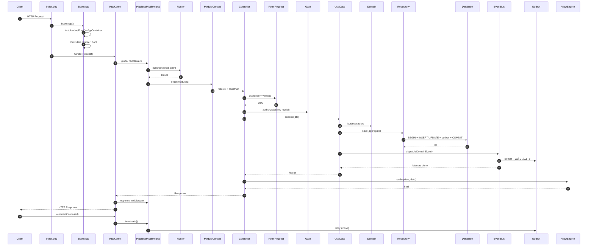

# DOC-025 — چرخهٔ عمر درخواست (Request Lifecycle) 🔒

| متادیتا | مقدار |
|---|---|
| DOC-ID | DOC-025 |
| وضعیت | Approved v1.0 |
| نقش | مدل ذهنی اجرای تَوان؛ مرجع دیباگ و بهینه‌سازی |
| Entry Points | `public/index.php`, `bin/tvn`, Worker, Scheduler, Realtime |

---

## ۱. نمای کلی ۱۴ فاز

```
┌──── BOOTSTRAP (یک‌بار در Resident، هر درخواست در FPM) ────────────────────┐
│ P1  Entry Point                                                          │
│ P2  Autoloader Registration                                              │
│ P3  Environment & Config Loading                                         │
│ P4  Container Creation & Core Bindings                                   │
│ P5  Provider Registration (register)                                     │
│ P6  Provider Booting (boot)                                              │
└──────────────────────────────────────────────────────────────────────────┘
┌──── REQUEST ─────────────────────────────────────────────────────────────┐
│ P7  Request Capture & Normalization                                      │
│ P8  Global Middleware Pipeline                                           │
│ P9  Route Matching (Compiled)                                            │
│ P10 Module/Controller Resolution (HMVC) + Route Middleware                │
│ P11 Action Invocation (FormRequest → Policy → UseCase → Domain → Infra)  │
│ P12 Response Construction (View / Resource / Stream)                     │
└──────────────────────────────────────────────────────────────────────────┘
┌──── RESPONSE ────────────────────────────────────────────────────────────┐
│ P13 Send Response                                                        │
│ P14 Terminate (Session write, Log flush, Metrics export, Queue inline)   │
└──────────────────────────────────────────────────────────────────────────┘
```

---

## ۲. تشریح فازها

### P1 — Entry Point
```php
<?php
// public/index.php — تنها فایل اجرایی عمومی
declare(strict_types=1);

use Tavaan\Bootstrap\ApplicationBuilder;
use Tavaan\Engine\Http\HttpKernel;
use Tavaan\Engine\Http\Request;

// ۱) مسیر پایه
define('TVN_START', microtime(true));
define('TVN_BASE_PATH', dirname(__DIR__));

// ۲) بوت‌استرپ (بدون composer)
require TVN_BASE_PATH . '/core/bootstrap.php';

// ۳) ساخت اپلیکیشن
$app = ApplicationBuilder::create(TVN_BASE_PATH)
    ->withEnvFile('.env')
    ->withConfig(basePath: TVN_BASE_PATH . '/config')
    ->withModules(basePath: TVN_BASE_PATH . '/modules')
    ->withProvidersFromFile(TVN_BASE_PATH . '/config/providers.php')
    ->boot();

// ۴) اجرای درخواست
$kernel = $app->make(HttpKernel::class);
$response = $kernel->handle(Request::capture());
$response->send();
$kernel->terminate(Request::capture(), $response);
```
🔒 هیچ منطق کسب‌وکاری در Entry Point.
🔒 `TVN_START` برای اندازه‌گیری زمان بوت.

### P2 — Autoloader
→ جزئیات کامل در `docs/03-engines/autoloader.md`
```
Autoloader::register()
  ├─ ثبت SPL Autoload Function
  ├─ بارگذاری ClassMap کش‌شده (در صورت وجود)
  └─Fallback: نگاشت PSR-4-like namespace → path
```

### P3 — Environment & Config
```
Env::load(basePath/.env)                 ← بدون putenv (امنیت)
  → EnvRepository (in-memory, typed cast)
Config::loadFiles(basePath/config/*.php) ← lazy per-file
  → Repository با dot-notation
  → اگر storage/cache/config.php موجود باشد → بارگذاری کش (۱ فایل)
  → Schema Validation (اختیاری در dev)
```
🔒 ترتیب: ENV → Config File → `Config::set()` در Provider.

### P4 — Container
```
$app = new Container()
  ├─ instance(ContainerInterface::class, $app)
  ├─ instance(Application::class, $app)
  ├─ bind singleton: config, events, log, encrypter, url, request, response
  └─ bind interfaces → implementations (از config/*.php)
```

### P5 — Provider Registration
```
foreach ($providers as $providerClass) {
    $provider = new $providerClass($app);
    if ($provider instanceof DeferrableProvider && !$needed) continue;
    $provider->register();          // فقط binding — بدون side effect
}
```
🔒 در `register()` ممنوع: استفاده از سرویس دیگر، دسترسی به Config ماژول دیگر، I/O.

### P6 — Provider Booting
```
$app->booted = false;
foreach ($providers as $provider) {
    if (method_exists($provider, 'boot')) {
        $app->call([$provider, 'boot']);   // با تزریق وابستگی
    }
}
$app->booted = true;
$events->dispatch(new KernelBooted(bootTimeMs: ...));
```

### P7 — Request Capture
```php
Request::capture()
  ├─ از $_SERVER, $_GET, $_POST, $_COOKIE, $_FILES, php://input
  ├─ Normalization:
  │    ├─ Method Override (_method, X-HTTP-Method-Override)
  │    ├─ Path: حذف base path، urldecode، یکسان‌سازی `/`
  │    ├─ Trusted Proxy → IP واقعی (X-Forwarded-For با Allowlist)
  │    ├─ Encoding → UTF-8 (NFC normalize)
  │    └─ Sanitize: حذف control chars، محدودیت طول
  ├─ ساخت Uri، HeaderBag، QueryBag، RequestBag، ServerBag، FileBag، CookieBag
  └─ Immutable Request (هر تغییر → withX())
```

### P8 — Global Middleware Pipeline
```
ترتیب پیش‌فرض (config/http.php → middleware.global):
 1. TrustProxiesMiddleware        ← قبل از هر چیز
 2. MaintenanceModeMiddleware
 3. SecurityHeadersMiddleware
 4. CorsMiddleware
 5. RequestSizeLimitMiddleware
 6. StartSessionMiddleware
 7. ShareErrorsFromSessionMiddleware
 8. CsrfVerifyMiddleware
 9. AuthenticationMiddleware      (lazy)
10. RateLimitMiddleware
11. SetLocaleMiddleware
12. TraceContextMiddleware
```
🔒 Pipeline با Closure Nesting (بدون آرایهٔ mutable):
```php
$pipeline = array_reduce(
    array_reverse($middleware),
    static fn (\Closure $next, string $mw): \Closure
        => static fn (RequestInterface $r): ResponseInterface
            => $container->make($mw)->handle($r, $next),
    static fn (RequestInterface $r): ResponseInterface => $destination($r),
);
$response = $pipeline($request);
```

### P9 — Route Matching
```
1. اگر storage/cache/routes.php موجود → CompiledMatcher
2. وگرنه RouteCollection::match()
3. الگوریتم:
   a. Bucket بر اساس Method
   b. Trie/Regex-Chunk بر اساس Segment
   c. تطبیق Static → Parametric → Wildcard
   d. اعمال `where` Constraints
   e. Domain/Host matching
   f. Scheme (http/https) matching
4. خروجی: Route + params + middleware + action
5. اگر نبود → 405 (اگر path با method دیگر بود) یا 404
```

### P10 — Module/Controller Resolution
```
route.action = 'Modules\Shop\Http\Controllers\ProductController@show'
  یا ['controller' => ..., 'method' => ...] یا Closure
1. تشخیص ماژول از namespace → ModuleContext::enter('tavaan.shop')
2. Resolve Controller از Container (با تزریق Constructor)
3. Resolve Route Middleware (از route + group + controller attribute)
4. اجرای Route Middleware Pipeline
5.HMVC: اگر target یک Widget باشد → ModuleRunner::run()
```

### P11 — Action Invocation
```
1. Resolve پارامترهای متد:
   a. FormRequest در امضا → ساخته، authorize()، validate() → DTO
   b. Route Parameter → Cast (int/string/enum/Model Binding)
   c. Query/Body → از Request
   d. بقیه از Container
2. Authorization:
   a. #[Policy] Attribute یا $this->authorize() در Controller
   b. Gate->authorize(ability, model)
3. فراخوانی UseCase/Handler (Application Layer)
   → Domain → Infrastructure
4. Transaction Boundary در UseCase
5. Domain Events → Outbox → Listeners
6. برگرداندن نتیجه
```

### P12 — Response Construction
```
نوع خروجی Action          → تبدیل
─────────────────────────────────────────
ResponseInterface         → همان
string                    → HtmlResponse (200)
array|Jsonable|Arrayable  → JsonResponse (200)
Model|Collection          → JsonResource یا View (بر اساس Accept)
View                      → HtmlResponse
RedirectResult            → RedirectResponse (302)
null                      → NoContentResponse (204)
PaginatorInterface        → JsonResource با meta
```
سپس:
```
→ Response Middleware (after)
→ View Render (اگر lazy)
→ Compression (gzip/br اگر client پشتیبانی و size > 1KB)
→ ETag / Last-Modified / Cache-Control
→ Cookie Queue → Set-Cookie Headers
```

### P13 — Send
```php
public function send(): never
{
    if (!\headers_sent()) {
        \http_response_code($this->statusCode());
        foreach ($this->headers() as $name => $values) {
            foreach ($values as $v) { \header("{$name}: {$v}", false); }
        }
    }
    echo $this->body();
    if (\function_exists('fastcgi_finish_request')) { \fastcgi_finish_request(); }
    // …
}
```

### P14 — Terminate
```
1. Middleware::terminate() برای همهٔ middlewareها (ترتیب معکوس)
2. Session Write & Close
3. Log Flush (buffer → disk/remote)
4. Metrics Export (اگر inline)
5. Queue "inline" jobs (اگر config = after_response)
6. FastCGI finish_request → کاربر پاسخ را زودتر می‌گیرد
7. Provider::shutdown() (در Resident: reset state)
8. Memory cleanup برای Worker (جلوگیری از leak)
```

---

## ۳. نمودار توالی کامل



---

## ۴. تفاوت چرخه در Entry Pointهای دیگر

| فاز | HTTP | CLI | Queue Worker | Scheduler | Realtime |
|---|---|---|---|---|---|
| P1..P6 | هر درخواست (FPM) / یک‌بار (Swoole) | یک‌بار | یک‌بار | یک‌بار | یک‌بار |
| P7 | Request::capture | ArgvInput | Pop Job | Cron Tick | WS Frame |
| P8 | Global MW | Console MW | Job MW | Task MW | Connection MW |
| P9 | Route Match | Command Match | Job Resolve | Task Resolve | Channel Match |
| P10 | Controller | Command Class | Job Class | Closure | Handler |
| P11 | Action | handle() | handle() | run() | onMessage() |
| P12 | Response | Output | Ack/Fail | Output | Frame |
| P13 | send() | flush stdout | delete/release | — | push |
| P14 | terminate | shutdown | next job / graceful stop | — | keep-alive |

### ۴٫۱ نکات حالت Resident (Swoole/FrankenPHP/RoadRunner)
🔒 در حالت Resident، **باید** پس از هر درخواست:
1. `Container::flushRequestScoped()` — حذف سرویس‌های per-request
2. `RequestStack::reset()`
3. `Context::reset()` (Fiber-local)
4. بستن Cursorها و آزادسازی Statementها
5. ریست `Model::$booted` cache در صورت نیاز
6. بررسی `memory_get_usage()` → اگر > آستانه، Recycle Worker

---

## ۵. Request/Response Scoping

| Scope | عمر | مثال |
|---|---|---|
| `singleton` | کل فرایند | Config, Events, Log |
| `request` | یک درخواست | Request, Auth Guard, DB Connection (FPM) |
| `job` | یک Job | Job Context |
| `transient` | هر make | FormRequest, DTO |

```php
$app->scoped(RequestContext::class);     // PHP 8.0+ pattern
$app->flushRequestScoped();              // در terminate / resident reset
```

---

## ۶. نقاط اندازه‌گیری (Profiling Points)

| Span | شروع | پایان | هدف |
|---|---|---|---|
| `boot` | TVN_START | پس از P6 | ≤ ۸ms |
| `middleware.global` | P8 شروع | P8 پایان | ≤ ۲ms |
| `route.match` | P9 | P9 | ≤ ۰٫۰۰۵ms |
| `controller.resolve` | P10 | P10 | ≤ ۰٫۵ms |
| `validation` | P11 | P11 | ≤ ۱ms |
| `usecase` | P11 | P11 | وابسته به دامنه |
| `db.query` | هر کوئری | هر کوئری | ≤ ۵ms (p95) |
| `view.render` | P12 | P12 | ≤ ۲ms |
| `response.compress` | P12 | P12 | ≤ ۱ms |
| `terminate` | P14 | P14 | ≤ ۱ms (خارج از زمان کاربر) |

---

## ۷. اشکال‌زدایی چرخه

| علامت | علت احتمالی | ابزار |
|---|---|---|
| صفحهٔ سفید | خطای Fatal قبل از ErrorHandler | `error_log`, `tvn serve -d display_errors=1` |
| ۴۰۴ روی همهٔ روت‌ها | Rewrite/`public` اشتباه یا Route Cache قدیمی | `tvn route:clear && tvn route:list` |
| ۴۱۹ | CSRF یا Session Store خراب | `tvn session:clear`, بررسی Cookie |
| ۵۰۰ بدون جزئیات | `app.debug=false` | `tvn log:tail`, `refCode` |
| کندی اولین درخواست | نبود Config/Route Cache | `tvn optimize` |
| Memory growth در Worker | State نشت‌کرده | `tvn queue:work --max-memory=128` |
| Middleware اجرا نمی‌شود | ثبت نشده یا Order اشتباه | `tvn middleware:list` |

---

## ۸. معیار پذیرش 🧪

- AC-LC-01: زمان بوت (P1..P6) در محیط مرجع ≤ ۸ms با opcache گرم.
- AC-LC-02: هر ۱۴ فاز در `Debug Bar` با زمان مجزا نمایش داده می‌شود.
- AC-LC-03: در حالت Resident پس از ۱۰۰٬۰۰۰ درخواست رشد حافظه ≤ ۵٪.
- AC-LC-04: `terminate()` حتی در صورت خطا در P12 اجرا می‌شود (تست با Exception).
- AC-LC-05: Session فقط یک‌بار در P14 نوشته می‌شود.
- AC-LC-06: در CLI هیچ Header/Session/CSRF Middleware اجرا نمی‌شود.
- AC-LC-07: تغییر Entry Point (HTTP→CLI) نیاز به تغییر کد Application ندارد.
